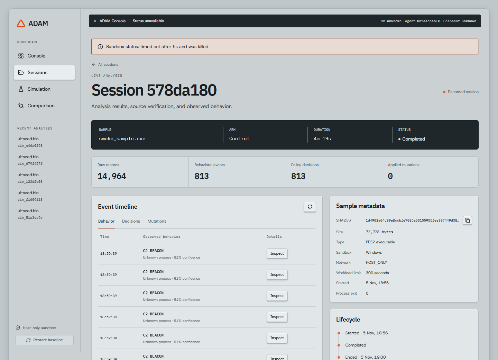
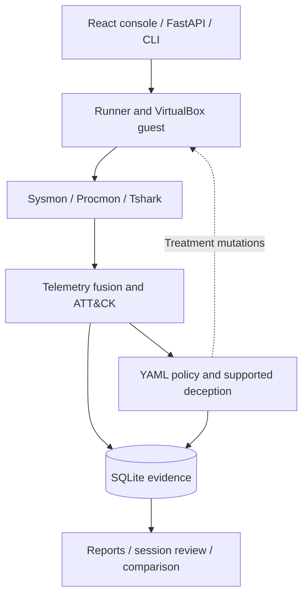
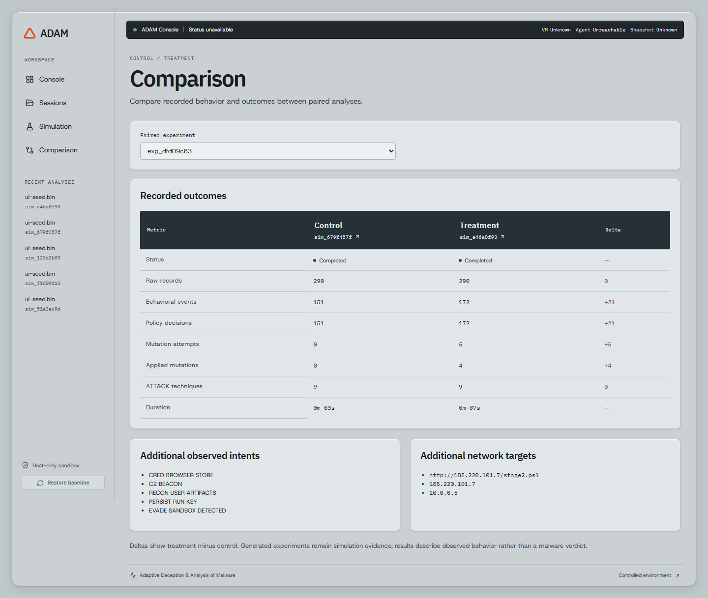

# ADAM

**Controlled malware analysis. Adaptive deception. Inspectable evidence.**

ADAM is a research and engineering platform for observing Windows executables in an instrumented VirtualBox guest. It correlates telemetry with MITRE ATT&CK, evaluates YAML policies, and can introduce controlled deception to study changes in observed behavior.


[Quick start](#quick-start) · [Architecture](#architecture) · [Documentation](docs/README.md) · [Verification](docs/frontend-verification.md)



*A historical real control session viewed in the React console. Recorded completion describes that session; the system ribbon reports the host state at screenshot time.*

## What it does

| Capability | Implementation |
| --- | --- |
| Controlled execution | Restore a configured baseline, stage a sample, execute in the Windows guest, and attempt cleanup. |
| Instrumented capture | Collect and parse Sysmon events, Procmon exports, and Tshark packet evidence. |
| Behavioral analysis | Fuse telemetry into intent events and ATT&CK mappings; retain the underlying records. |
| Adaptive deception | Evaluate rules, cooldowns, and budgets before applying supported guest mutations. Control runs observe without applying deception. |
| Investigation | Browse sessions, events, decisions, mutations, observed indicators, source outcomes, and structured failures. Download retained evidence and HTML, Markdown, or JSON reports. |
| Paired experiments | Compare control and treatment records. Synthetic simulation and replay are labeled separately from real VM analysis. |

## Quick start

### 1. Install

Use **Python 3.11+** and **Node.js 22.12+**; Node.js 24 LTS is also supported by the frontend toolchain. Commands below use PowerShell from the repository root.

```powershell
git clone https://github.com/nivedpatel1403/Adam.git
cd Adam
python -m venv .venv
.\.venv\Scripts\python.exe -m pip install -e ".[dev]"
Copy-Item .env.example .env
```

The settings loader requires guest credential fields even for synthetic replay. The template supplies example values; replace them with your guest credentials before any live execution. Keep `.env` local. Run commands from the repository root so configuration and rule paths resolve correctly.

### 2. Try synthetic replay — no VM required

```powershell
.\.venv\Scripts\python.exe -m adam.cli.main replay synthetic
```

This runs generated events through the analysis pipeline and stores a labeled replay session. It does **not** execute a sample or establish live capture health.

### 3. Open the React console

Start the API in one terminal:

```powershell
.\.venv\Scripts\python.exe -m uvicorn adam.api.main:app --host 127.0.0.1 --port 8000
```

Start the frontend in a second terminal, initially at the repository root:

```powershell
cd frontend/adam-ui
npm ci
npm run dev -- --host 127.0.0.1
```

Open [the console](http://127.0.0.1:5173) or [the API documentation](http://127.0.0.1:8000/docs). Use **Simulation** with a seed file to explore generated behavior without a VM. Live launch remains unavailable when sandbox status cannot be established. See the [console guide](frontend/adam-ui/README.md) for routes, downloads, and browser-test requirements.

### 4. Run a provisioned VM — optional

Live execution requires VirtualBox, a configured Windows guest with the ADAM HTTP agent, Sysmon, Procmon, Tshark/Npcap, a verified baseline snapshot, and host-only networking. **Sample executables, tool installers, VM images, and local databases are not included in this repository.** A built-in sample appears in the UI only if its executable is present locally.

Follow [guest setup and configuration](docs/guest-provisioning-guide.md), then use your own benign test executable:

```powershell
.\.venv\Scripts\python.exe -m adam.cli.main run "samples\your-benign-sample.exe" --arm control --timeout-seconds 90 --artifacts-dir "artifacts\first-run"
```

Control is the recommended first run. Guest readiness and workload execution have separate deadlines. Keep execution inside the isolated guest, and allow only one CLI, API launch, or verification harness to own the VM at a time.

## Architecture



The live pipeline uses an asynchronous event bus. Synthetic modes exercise analysis engines with generated inputs; they do not replace real capture verification. The [architecture specification](ARCHITECTURE.md) records the original design; the [documentation index](docs/README.md) identifies implementation and verification references.

## Control and treatment



*A completed synthetic pair using generated events. These deltas illustrate the comparison workflow, not measured malware-detection effectiveness or real guest execution.*

## Verification and current limits

ADAM is a research prototype, not a production-ready security service.

- **Historical live acceptance — November 5, 2026:** controlled real-VM cycles recorded correlated Sysmon, Procmon, and network evidence, restoration checks, and guarded baseline promotion. See the [dated acceptance report](docs/repair-verification.md).
- **Frontend verification — November 6, 2026:** 543 backend tests passed with one skip; 5 component tests and 8 browser checks passed. The production build and relevant lint checks passed. These are dated results, not live CI badges.
- **Latest live retest:** blocked before launch by VirtualBox state-query timeouts. Startup reliability remains unresolved; the historical acceptance does not establish current VM health.
- **Network deception:** a bounded plain-HTTP lure proxy supports clients that use it. HTTPS/CONNECT, TLS pinning, raw sockets, and clients bypassing proxy settings are outside that proof.

See [frontend verification](docs/frontend-verification.md) and [known limitations](docs/known_limitations.md) for scope and evidence availability. Raw verification logs and captures remain local and are not published with the source.

## Development checks

From the repository root:

```powershell
.\.venv\Scripts\python.exe -m pytest tests/unit tests/integration -q
```

From `frontend/adam-ui`:

```powershell
npm test
npm run lint
npm run build
```

Browser checks require running servers and recorded-session fixtures; deliberate live-VM checks are opt-in. Follow the [console verification instructions](frontend/adam-ui/README.md#verify).

## Documentation

| Start here | Details |
| --- | --- |
| [Documentation index](docs/README.md) | Setup, architecture, rules, operations, and dated evidence. |
| [React console](frontend/adam-ui/README.md) | Primary interface, local startup, and verification. |
| [Guest setup](docs/guest-provisioning-guide.md) | Local configuration, tooling, and isolation requirements. |
| [Policy and deception reference](docs/policy_deception_reference.md) | Supported behavior and rule/deception concepts. |
| [Rule authoring](docs/rule_authoring.md) | YAML policy authoring. |
| [Network interception](docs/network-interception.md) | Exact proxy behavior and transport limits. |

The legacy Streamlit dashboard remains available: install `requirements-frontend.txt`, then run `.\.venv\Scripts\python.exe -m streamlit run frontend/app.py` from the repository root. React is the primary console described above.
